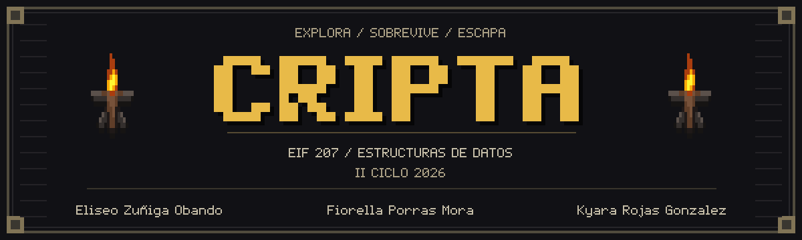
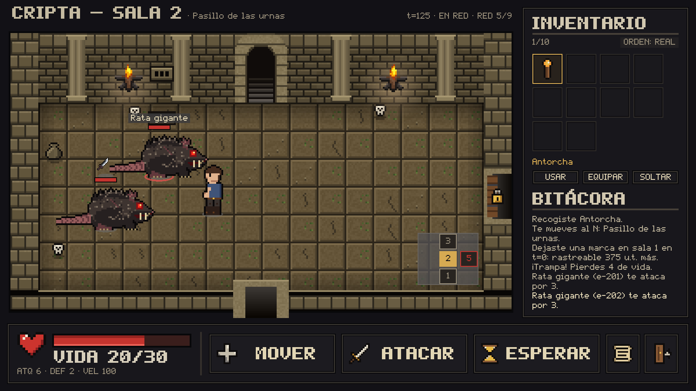

<div align="center">



### EIF 207 · Estructuras de Datos · II Ciclo 2026

Juego de exploración de mazmorras **online**, con pixel art, simulación por eventos y estructuras de datos propias.
Explora salas, administra tu inventario y encuentra las llaves para escapar con vida.

<p>
  
  
  
  
</p>

[Instalación](#instalación-desde-cero) · [Cómo jugar](#primera-partida) · [Controles](#controles) · [Comandos](#comandos) · [Documentación](#arquitectura-y-documentación)

</div>



## Qué incluye

- Modo principal **online**, conectado a la API del curso, y alternativa offline con datos incluidos.
- Combate, enemigos con distintos comportamientos, trampas, efectos temporales y rastro del jugador.
- Inventario con equipo visible, vistas ordenadas y retroceso de las últimas cinco acciones mediante pergaminos.
- Minimapa clickeable, animaciones, música, efectos de sonido y configuración de volumen y pantalla.
- Guardado binario, puntajes, reproducción determinista de partidas y mediciones de rendimiento.

La simulación avanza por **eventos y reloj virtual**, con tiempos según la acción y la velocidad de cada actor. Las animaciones y el tiempo que tardas en decidir no adelantan ese reloj.

## Instalación

Necesitas [Git](https://git-scm.com/downloads), **Python 3.13 o superior** y **uv**. Los comandos siguientes instalan Python con uv si todavía no lo tienes. La ventana requiere un equipo con controladores gráficos compatibles con [OpenGL 3.3 o superior](https://api.arcade.academy/en/latest/get_started/install.html).

### 1. Instalar Git

Si `git --version` ya muestra una versión, continúa con el siguiente paso.

**Windows (PowerShell, con WinGet):**

```powershell
winget install --id Git.Git -e --source winget
```

Si no tienes WinGet, descarga y ejecuta el [instalador oficial de Git para Windows](https://git-scm.com/install/windows), manteniendo la opción de usar Git desde la línea de comandos.

**Ubuntu / Debian:**

```sh
sudo apt update
sudo apt install git
```

**macOS:** ejecuta el siguiente comando y acepta la instalación de las herramientas de línea de comandos de Xcode si el sistema la solicita:

```sh
git --version
```

Al terminar la instalación, vuelve a abrir la terminal y verifica `git --version`. Para otras distribuciones, consulta la [guía oficial de instalación de Git](https://git-scm.com/book/en/v2/Getting-Started-Installing-Git).

### 2. Instalar uv

En **Windows**, abre PowerShell:

```powershell
powershell -ExecutionPolicy ByPass -c "irm https://astral.sh/uv/install.ps1 | iex"
```

En **Linux o macOS**, abre una terminal:

```sh
curl -LsSf https://astral.sh/uv/install.sh | sh
```

Vuelve a abrir la terminal y comprueba la instalación con `uv --version`. Hay otras opciones en la [guía oficial de uv](https://docs.astral.sh/uv/getting-started/installation/).

### 3. Descargar y preparar el proyecto

```sh
git clone https://github.com/oesiledivad/EIF207_Proyecto_01.git
cd EIF207_Proyecto_01
uv python install 3.13
uv sync --locked
```

`uv sync --locked` crea `.venv` e instala las versiones de `uv.lock`: Arcade para la interfaz, Pillow para imágenes y Requests para HTTP, junto con sus dependencias. No necesitas configurar un IDE ni crear un archivo `.env`.

**Activar el entorno virtual es opcional:** `uv run` lo utiliza automáticamente. Si prefieres ejecutar los comandos directamente, actívalo desde la raíz del proyecto:

**Windows (PowerShell):**

```powershell
.\.venv\Scripts\Activate.ps1
```

**Windows (CMD):**

```bat
.venv\Scripts\activate.bat
```

**Linux / macOS (Bash o Zsh):**

```sh
source .venv/bin/activate
```

Con el entorno activo puedes ejecutar `cripta` directamente; para salir del entorno, usa `deactivate`. Si PowerShell bloquea la activación, puedes seguir usando `uv run cripta` sin activar nada. Consulta también la [guía de entornos de uv](https://docs.astral.sh/uv/pip/environments/).

### 4. Abrir el juego online

```sh
uv run cripta
```

Ejecuta los comandos desde la raíz del repositorio. El modo online es el predeterminado: consulta la API del curso y muestra las criptas disponibles. Necesitas conexión a Internet para instalar las dependencias y para jugar en este modo.

Si quieres jugar sin conexión, utiliza la alternativa `uv run cripta --offline`, con los datos incluidos o descargados previamente.

## Primera partida

Al abrir `uv run cripta`, espera la pantalla de carga del catálogo online.

1. Selecciona una cripta en el menú; para empezar, usa **Osario menor** (`cripta-01`).
2. Escribe tu nombre. La semilla puede quedar vacía; un mismo número permite repetir el azar de una partida con los mismos datos.
3. Pulsa **Iniciar partida**. Haz clic en los objetos del suelo para recogerlos y en las puertas para abrirlas o cruzarlas. Algunas requieren una llave.
4. Selecciona un enemigo y pulsa **A**, o haz doble clic sobre él para atacar. Revisa la vida, los efectos y la bitácora después de actuar.
5. Busca la llave de salida y entra por el acceso correspondiente para ganar. Si mueres, puedes reintentar o volver al menú principal.

**Guardar y continuar:** abre **Esc → Guardar partida**. Para recuperarla, usa **Continuar partida** en el menú principal o **Cargar partida guardada** dentro del juego y elige el jugador y la cripta. Salir no sustituye el guardado manual.

**Configuración:** permite ajustar música y efectos con sliders y alternar pantalla completa. Los ajustes se mantienen durante la sesión. El menú de **Cheats** es solo para pruebas: utilizarlo deshabilita puntajes, guardado y registro de replay para esa partida.

## Controles

| Acción                                                    | Ratón o teclado                                              |
|-----------------------------------------------------------|--------------------------------------------------------------|
| Abrir o cruzar una puerta                                 | Clic en la puerta; flechas para moverse por salidas abiertas |
| Moverse con el minimapa                                   | Clic en una sala vecina accesible                            |
| Seleccionar / atacar enemigo                              | Clic / doble clic, o **A** tras seleccionarlo                |
| Recoger un objeto del suelo                               | Clic, o **R** con el cursor sobre él                         |
| Seleccionar objeto del inventario                         | Clic, **Tab** o **Shift + Tab**                              |
| Usar / equipar / soltar objeto seleccionado               | **U** / **E** / **S** o **D**, o sus botones                 |
| Esperar / usar pergamino de retroceso                     | **.** / **P**                                                |
| Orden visual del inventario: peso / valor / nombre / real | **Alt + P / V / N / R**                                      |
| Información de la sala y del rastro                       | **I**                                                        |
| Ayuda / menú / terminar con confirmación                  | **F1** o **/** / **Esc** / **Q**                             |
| Pantalla completa / silenciar efectos / silenciar música  | **F11** / **F2** / **F3**                                    |

La ayuda del juego reúne los controles adicionales. El minimapa marca en dorado la salida y en rojo las puertas cerradas. La cabecera muestra el modo de conexión y las solicitudes utilizadas frente al presupuesto de red.

## Comandos

### Jugar online

Abre el menú principal y consulta las criptas de la API del curso. Es el modo predeterminado y requiere conexión a Internet; los datos descargados se conservan en caché.

```sh
uv run cripta
```

### Jugar offline

Utiliza primero lo descargado en `.cripta_cache/` y después el paquete `datos_prueba/`, sin consultar la red.

```sh
uv run cripta --offline
```

Una cripta descargada se usa con su versión en caché; una sala que falte allí no se completa mezclando otra versión. Las fichas de catálogo también deben ser compatibles.

### Preseleccionar cripta, jugador y semilla

Rellena los valores iniciales del menú. Este ejemplo utiliza la cripta local Stormlight y la semilla `42`; pulsa **Iniciar partida** para comenzar.

```sh
uv run cripta --offline --cripta cripta-stormlight --nombre "Explorador" --semilla 42
```

La misma semilla permite repetir el azar con los mismos datos y acciones. Omítela para generar una aleatoria; para preseleccionar una cripta online, usa su identificador y quita `--offline`.

### Reproducir una partida

Ejecuta las acciones registradas en un `.log` sin abrir una ventana. Sustituye la ruta del ejemplo por un archivo existente:

```sh
uv run cripta --offline --replay partidas/cripta_01_partida_00001.log
```

Exige las versiones originales de la cripta y el catálogo. Quita `--offline` para permitir consultar la API si esos datos no están disponibles localmente. El replay reproduce un registro; para seguir jugando utiliza **Continuar partida** y un guardado binario.

### Medir rendimiento

Ejecuta mediciones de agenda, caché, inventario, retroceso, ordenamientos y persistencia, además de ciclos completos de la referencia y cargas sintéticas. No consulta la red ni abre la interfaz.

```sh
uv run cripta --bench
```

Los resultados aparecen en la terminal y dependen del equipo y de la carga evaluada.

### Consultar la ayuda

Muestra las opciones disponibles y termina sin abrir el juego:

```sh
uv run cripta --help
```

### Opciones adicionales

Puedes añadir estas opciones al comando de arranque para ajustar la capacidad de caché o las rutas de los archivos:

| Opción                              | Función y valor predeterminado                                           |
|-------------------------------------|--------------------------------------------------------------------------|
| `--cripta`, `--nombre`, `--semilla` | Preselección del menú; nombre `Jugador`, semilla aleatoria si está vacía |
| `--cache-size 25`                   | Capacidad de fichas de catálogo en memoria; debe ser positiva            |
| `--cache-dir .cripta_cache`         | Carpeta de caché persistente                                             |
| `--offline-dir datos_prueba`        | Paquete local de respuestas de la API                                    |
| `--log-dir partidas`                | Carpeta de registros de partida                                          |
| `--puntajes RUTA`                   | Archivo de puntajes; por defecto, `puntajes.json` dentro de `--log-dir`  |

Ejemplos de uso; puedes combinar varias opciones en una misma ejecución:

```sh
# Preseleccionar una cripta online, el nombre y la semilla
uv run cripta --cripta cripta-01 --nombre "Explorador" --semilla 42

# Permitir hasta 50 fichas de catálogo en memoria
uv run cripta --cache-size 50

# Guardar la caché descargada en otra carpeta
uv run cripta --cache-dir "cache_pruebas"

# Usar el paquete local indicado para jugar offline
uv run cripta --offline --offline-dir "datos_prueba"

# Guardar registros y puntajes en otra carpeta
uv run cripta --log-dir "partidas_prueba"

# Elegir un archivo de puntajes distinto
uv run cripta --puntajes "partidas/puntajes_prueba.json"
```

Ejecuta solo el ejemplo que necesites. Las líneas que empiezan con `#` son comentarios para PowerShell, Bash y Zsh; en CMD copia únicamente las líneas que empiezan con `uv run`.

## Archivos generados

| Ubicación predeterminada               | Contenido                                                                                 |
|----------------------------------------|-------------------------------------------------------------------------------------------|
| `.venv/`                               | Entorno de Python y dependencias instaladas por uv                                        |
| `.cripta_cache/`                       | Versiones, catálogo y datos de criptas descargados                                        |
| `partidas/cripta_01_partida_00001.log` | Ejemplo de registro de acciones para replay; el nombre incluye la cripta y un consecutivo |
| `partidas/puntajes.json`               | Resultados, jugador, versión de cripta, acciones, enemigos derrotados y tiempo virtual    |
| `partidas/guardadas/*.bin`             | Guardados por jugador y partida, en formato binario propio                                |

Los archivos de ejecución están excluidos de Git. Los `.log` y los `.bin` cumplen funciones distintas; conserva ambos si quieres reproducir acciones y también continuar una partida.

## Pruebas y límites conocidos

Para ejecutar una selección de pruebas de partida, inventario, retroceso, guardado, replay, mediciones e interfaz:

```sh
uv run python -m unittest pruebas.test_partida pruebas.test_inventario pruebas.test_retroceso pruebas.test_guardado pruebas.test_replay pruebas.test_bench pruebas.test_grafica
```

Las pruebas gráficas requieren un entorno con pantalla y soporte OpenGL, aunque sus ventanas estén ocultas.

- **Rendimiento:** la referencia cargada cumple el objetivo de ciclos inferiores a 20 ms en el equipo de desarrollo, excluyendo red y renderizado. Las cargas de estrés, incluida la de 1000 enemigos, no garantizan ese límite. Influyen el equipo, los eventos simultáneos, la implementación y las pausas del recolector de memoria; ejecuta `--bench` para medir en tu entorno.
- **Datos y red:** jugar en línea depende de la disponibilidad de la API y de su presupuesto de solicitudes. Offline y replay dependen de los datos y versiones disponibles en disco.
- **Presupuesto agotado dentro de una cripta:** la partida sigue activa y la cabecera muestra `AGOTADO`. Puedes continuar con los datos ya disponibles; una acción que necesite descargar contenido se rechaza sin avanzar el reloj ni gastar una acción. Usa **I** para ver la explicación o **Esc** para guardar y volver al menú. No se renueva el presupuesto al reintentar ni se cambia automáticamente a offline. El guardado conserva el progreso; cargarlo exige datos y versiones compatibles.
- **Caché:** las fichas en uso no se desalojan. Si una escena necesita más tipos protegidos que la capacidad configurada, aumenta `--cache-size` al iniciar.
- **Restricciones académicas:** agenda, inventario, caché y demás estructuras evaluadas son propias. Los formatos internos exigidos por bibliotecas permitidas, como el estado nativo de `random`, no se utilizan para sustituir esas estructuras.

## Arquitectura y documentación

El proyecto separa **Modelo–Vista–Controlador**. La vista usa Arcade; el modelo funciona sin ventana, y los adaptadores resuelven el acceso a HTTP y archivos.

| Carpeta                                      | Responsabilidad                                                      |
|----------------------------------------------|----------------------------------------------------------------------|
| `src/cripta/modelo/` y `estructuras/`        | Entidades, reglas y estructuras de datos propias                     |
| `src/cripta/controlador/`                    | Coordinación de partida, exploración, combate, inventario y guardado |
| `src/cripta/servicio/` y `adaptadores/`      | Catálogo, precarga, red, caché persistente y fuente offline          |
| `src/cripta/vista/`                          | Interfaz gráfica y recursos de imagen, fuente y audio                |
| `src/cripta/replay/`                         | Registro y reproducción de acciones                                  |
| `datos_prueba/`, `pruebas/`, `herramientas/` | Datos offline, pruebas y utilidades de generación de recursos        |

- [Decisiones de diseño y análisis de estructuras](docs/decisiones.md).
- [Estructuras de datos: operaciones y complejidades](docs/estructuras.md).
- [Contrato de la API](docs/api.md).
- [Bitácora de uso de LLM](docs/PROMPTS_LLM.md).
- [Procedencia de los packs gráficos](src/cripta/vista/recursos/PACKS.md) y [términos de las antorchas de Szadi art](src/cripta/vista/recursos/catacombs/PROCEDENCIA.md).
- [Fuente Cripta Pixel](src/cripta/vista/recursos/fuente/PROCEDENCIA.md), [música](src/cripta/vista/recursos/musica/PROCEDENCIA.md) y [efectos de sonido propios](src/cripta/vista/recursos/sonidos/PROCEDENCIA.md). El arte propio del juego se distribuye exportado a PNG en `src/cripta/vista/recursos/propios/`; los recursos externos conservan sus respectivos términos de uso.

---

<div align="center">

**Eliseo Zuñiga Obando · Fiorella Porras Mora · Kyara Rojas Gonzalez**

Proyecto académico · Universidad Nacional de Costa Rica

</div>

### Replay de ejemplo incluido

Para probar la reproducción desde una instalación limpia, sin conexión ni partidas previas:

```sh
uv run cripta --offline --replay ejemplos/replay/cripta_01_demo.log
```

Usa los datos de `datos_prueba/` y muestra cada acción y el estado final en consola. Los puntajes se generan al jugar y pueden consultarse desde **Puntajes** en el menú de selección; no se incluyen resultados personales ni cachés en el repositorio.
